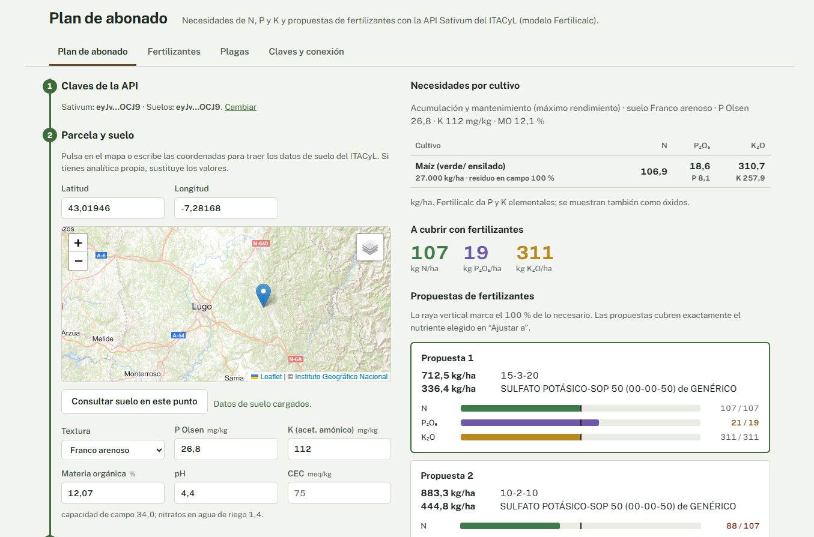

# Plan de abonado · Sativum

Aplicación web para calcular planes de abonado en toda España con la [API Sativum](https://portal.api.itacyl.es/portal/apis/) del Instituto Tecnológico Agrario de Castilla y León (ITACyL). Calcula las necesidades de nitrógeno, fósforo y potasio de un cultivo con el modelo Fertilicalc y propone combinaciones de fertilizantes comerciales para cubrirlas.

Es un único fichero `index.html`, sin compilación ni dependencias que instalar. Las llamadas a la API se hacen directamente desde el navegador.

## Funciones

**Plan de abonado.** Se rellena en cuatro pasos:

1. Claves de la API.
2. Parcela y suelo: al pulsar en el mapa se cargan la textura, el P Olsen, el K, la materia orgánica y el pH del servicio de suelos del ITACyL. Si tienes analítica propia, puedes sustituir cualquier valor.
3. Cultivo y rotación: el cultivo a abonar, su rendimiento, si se retira el residuo y, opcionalmente, los cultivos anteriores de la rotación.
4. Estrategia de abonado de P y K y nutriente al que ajustar las propuestas.

El resultado muestra las necesidades por cultivo, la cantidad de N, P₂O₅ y K₂O a aportar, y hasta cinco propuestas de fertilizantes. Cada propuesta indica con barras cuánto aporta de cada nutriente frente a lo necesario, para ver de un vistazo si se queda corta o se pasa. La petición y la respuesta completas se pueden descargar en JSON.

**Fertilizantes.** Búsqueda en el catálogo de fertilizantes por nombre, fabricante, tipo (NPK, NP, N…) y origen orgánico o mineral.

**Plagas.** Calendario semanal de niveles de alerta de plagas para el cultivo seleccionado o para un grupo de cultivos (cereales o leguminosas).

## Puesta en marcha

### Claves de la API

Las claves son gratuitas. Regístrate en el [portal del desarrollador del ITACyL](https://portal.api.itacyl.es/portal/apis/) y solicita una clave para cada uno de estos dos APIs:

| API | Para qué se usa |
|---|---|
| Sativum (balance de nutrientes) | Cultivos, cálculo Fertilicalc, fertilizantes, recomendaciones, plagas |
| Información de suelos | Datos de suelo por coordenadas |

Las dos claves se parecen mucho, porque empiezan y terminan igual, pero son distintas. Si una consulta responde *"Access to this API has been disallowed"*, estás usando la clave de un API en el otro.

Las claves se introducen en la pestaña **Claves y conexión**. Si marcas "Recordar las claves", se guardan en el `localStorage` de tu navegador. Solo se envían al gateway del ITACyL.

Cada persona que la use necesita sus propias claves. Ninguna clave se guarda en el repositorio.

### Uso local

Descarga el repositorio y abre `index.html` en el navegador.

## Criterios de cálculo

La aplicación construye la petición al algoritmo Fertilicalc con estos criterios:

**Valores por defecto según suelo y estrategia.** La capacidad de intercambio catiónico (CEC), los umbrales de P y K, el coeficiente de efecto del suelo y el factor de eficiencia salen de las tablas de la guía de servicios de balance de nutrientes del ITACyL. La CEC se puede cambiar a mano.

**Textura.** El valor de la capa de textura simplificada del servicio de suelos se traduce a los seis tipos de suelo de Fertilicalc (de arenoso a arcilloso), con la equivalencia de esa misma guía.

**Residuo en campo.** Fertilicalc llama residuo a toda la biomasa aérea que no es el producto cosechado (paja, cañote, rastrojo). El perfil de cada cultivo indica qué porcentaje queda en el campo cuando el residuo se retira. Si marcas que se retira, se usa ese valor; si no, se considera que queda el 100 %. El porcentaje también se puede fijar a mano.

**Unidades de P y K.** Fertilicalc devuelve P y K elementales, y el servicio de recomendación de fertilizantes también los recibe así: es él quien los convierte a P₂O₅ y K₂O para elegir y dosificar los productos. La aplicación envía los valores elementales y muestra las necesidades y los aportes en P₂O₅ (P × 2,2914) y K₂O (K × 1,2046), que son las unidades de las etiquetas de los fertilizantes.

**Estrategia de mantenimiento sin análisis de suelo.** La API exige valores de P y K del suelo aunque esta estrategia no los use. Si no los hay, se envían los umbrales de la tabla.

**Propuestas de fertilizantes.** Cubren exactamente el nutriente elegido en "Ajustar las propuestas a" (por defecto, el nitrógeno). Los otros dos pueden quedar por encima o por debajo.

## Endpoints utilizados

Todos pasan por `https://gateway.api.itacyl.es` con la clave en la cabecera `apikey`.

| Método | Ruta | Uso |
|---|---|---|
| GET | `/sativum/nutrients/crops` | Perfiles de cultivo |
| POST | `/sativum/fertilicalc/algo/` | Cálculo de necesidades de N, P y K |
| POST | `/sativum/nutrients/fertilizers/recommendation` | Propuestas de fertilizantes |
| GET | `/sativum/nutrients/fertilizers` | Catálogo de fertilizantes |
| GET | `/sativum/pests` | Calendario de plagas |
| GET | `/sativumarcgis/MapServer/identify` | Datos de suelo en un punto |

La documentación oficial está en el [portal del desarrollador del ITACyL](https://portal.api.itacyl.es/portal/apis/).

## Dependencias externas

Se cargan desde CDN y no hace falta instalarlas:

- [Leaflet](https://leafletjs.com/) 1.9.4 para el mapa, con el mapa base y la ortofoto PNOA del [Instituto Geográfico Nacional](https://www.ign.es/) (servicios WMTS, licencia CC BY 4.0). Si no cargan, las coordenadas se pueden escribir a mano.
- La tipografía [Public Sans](https://fonts.google.com/specimen/Public+Sans), de Google Fonts.

## Limitaciones

- El servicio de suelos solo devuelve datos dentro de la zona que cubre el ITACyL. Fuera de ella hay que introducir la analítica a mano.
- La aplicación no comprueba los límites legales de aporte de nitrógeno. En zonas vulnerables a la contaminación por nitratos, el máximo es de 170 kg/ha y año de N de origen orgánico (Real Decreto 47/2022). Revisa también la normativa de tu comunidad autónoma.
- Si la respuesta de recomendación no incluye la composición de un fertilizante, la aplicación la deduce de su nombre (por ejemplo, "16-5-15"). Con nombres comerciales sin esa notación, las barras de aporte pueden salir incompletas.

## Aviso

Este proyecto no es una aplicación oficial del ITACyL. Los resultados son orientativos y no sustituyen el criterio de un técnico agrónomo.

## Créditos

- Datos y servicios: [ITACyL](https://www.itacyl.es/) y su plataforma [Sativum](https://www.sativum.es/).
- Modelo de cálculo: Fertilicalc, de F. J. Villalobos (Universidad de Córdoba e Instituto de Agricultura Sostenible, CSIC), basado en el libro *Fitotecnia: principios de agronomía para una agricultura sostenible*.

---

## English summary

Single-page web app (one `index.html`, no build step) for the Sativum API of ITACyL, the agricultural technology institute of Castilla y León, Spain. It computes N, P and K crop requirements with the Fertilicalc model, proposes commercial fertilizer combinations, fetches soil properties by clicking on a map, and shows fertilizer catalog and pest alert calendars. Free API keys are available at the [ITACyL developer portal](https://portal.api.itacyl.es/portal/apis/). The interface is in Spanish.
